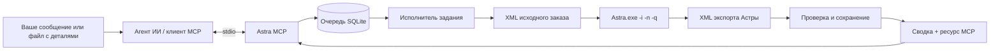

[](https://github.com/gagarinbefree/AstraMcp/actions/workflows/ci.yml)
[](https://github.com/gagarinbefree/AstraMcp/actions/workflows/ci.yml)
[](https://github.com/gagarinbefree/AstraMcp/releases/latest)


# Astra MCP

[Астра Раскрой: официальный сайт программы](https://astrapro.software/default.asp?page=astra-raskroj)

**Опишите агенту мебельные детали или укажите файл со списком. Он рассчитает их раскрой на ваших листах через «Астра Раскрой».**

Напишите в чате: «У меня шесть полок 720 × 450 мм. Разложи их на листе ЛДСП 2800 × 2070 мм». Или попросите взять размеры из файла. Агент подготовит заказ, передаст его установленной Астре, дождётся расчёта и расскажет, сколько листов понадобилось и какие детали удалось разместить.

Astra MCP подключает оптимизатор к вашему агенту ИИ через [Model Context Protocol](https://modelcontextprotocol.io/). После первоначальной настройки вы работаете через обычные сообщения в чате; подготовку XML и вызовы инструментов берёт на себя агент.

**Уже проверено:** 82 автоматических теста и 8 из 8 реальных заказов в Астре в фоновом режиме. Сохранены исходники, неизменённые XML результатов, журналы и отчёты независимой проверки геометрии. [Посмотреть результаты →](#результаты)

[Зачем это нужно](#зачем-это-нужно) · [Быстрый старт](#быстрый-старт) · [Инструменты](#инструменты) · [Пример работы](#пример-работы) · [Результаты](#результаты) · [Разработка](#разработка) · [Документация](#документация)

## Зачем это нужно

Вы собираете шкаф, делаете полки или готовите мебельный заказ. Список деталей уже есть в сообщении, таблице или файле, и нужно понять, как разместить их на имеющихся листах. С Astra MCP эту задачу можно поручить агенту привычными словами.

> У меня ЛДСП 16 мм, лист 2800 × 2070 мм. Нужно шесть полок 720 × 450 мм. Пропил 3.2 мм, отступы по краям 5 мм, поворот разрешён. Посчитай раскрой и скажи, хватит ли одного листа.

Агент собирает размеры и количества, при необходимости уточняет материал, толщину, доступные листы и параметры раскроя. Затем формирует заказ, запускает расчёт через MCP и объясняет результат: сколько деталей размещено, сколько листов использовано и что осталось неразмещённым. Файл с картами раскроя сохраняется для дальнейшей работы.

Если размеры уже записаны в файле, достаточно указать его агенту. Чтение таблиц и других документов выполняется средствами вашего агента; Astra MCP принимает подготовленный им заказ в XML. Для работы с файлами агенту нужен доступ к ним и инструмент чтения соответствующего формата.

Основной сценарий Astra MCP: **раскрой прямоугольных мебельных деталей из листовых материалов**. Сам раскрой вычисляет установленная Астра, а агент управляет подготовкой заказа и получением результата.

На [сайте разработчика Астры](https://astrapro.software/default.asp?page=astra-raskroj) описаны также задачи раскроя стекла и металла. Текущие примеры и реальные проверки этого MCP посвящены мебели; поддержку других производственных сценариев нужно проверять отдельно.

### Для кого

| Кому | Какую задачу решает |
| --- | --- |
| Мебельным мастерам | Раскрой деталей шкафа, тумбы или стеллажа по списку в сообщении |
| Мебельным мастерским | Расчёт заказа из файла со спецификацией деталей и доступных листов |
| Тем, кто делает мебель для себя | Проверка, хватит ли имеющегося листа на полки или другой небольшой проект |
| Пользователям агентов ИИ | Работа с оптимизатором через чат: сформулировать задачу, уточнить условия и получить результат |

### Что уже реализовано

* **Полный цикл расчёта:** проверка исходного XML, постановка в очередь, запуск Астры, ожидание экспорта, проверка результата.
* **Устойчивая очередь SQLite:** задания и статусы сохраняются между подключениями; повтор запроса с тем же ключом не создаёт второй расчёт.
* **Управление процессом:** ограничение времени, отмена и остановка дочернего процесса; отдельный запуск Астры для каждого задания.
* **Проверка соответствия заказу:** материалы, размеры, толщина, разрешение поворота, количество деталей и доступных листов.
* **Исходный XML результата:** файл сохраняется без изменения байтов и кодировки. Координаты деталей и отрезки резов остаются в том виде, в котором их экспортировала Астра.
* **Ответы для модели:** короткие текстовые сводки; подробный XML читается отдельным ресурсом MCP.
* **Проверяемость:** автоматические тесты адаптера и отдельный клиент .NET для реальных расчётов и проверки геометрии.

## Как это работает



Сервер использует файловый обмен и командную строку Астры. DLL SDK для этого сценария не требуется. На один настроенный EXE расчёты выполняются последовательно: общий профиль экспорта защищён от одновременного использования несколькими экземплярами MCP в одном пользовательском контексте Windows.

### Фоновый запуск

По умолчанию `RunInBackground=true`. Для каждого расчёта создаётся отдельный рабочий стол Windows. Окна Астры остаются на нём и не появляются на вашем мониторе. MCP не переключает активный рабочий стол; после завершения или отмены расчёта освобождает созданные ресурсы. Имя рабочего стола записывается в `execution.log`.

Для диагностики установите `RunInBackground=false` и перезапустите MCP. Астра будет открываться обычным окном. Если фоновый запуск недоступен, задание завершится ошибкой; автоматического перехода к видимому окну нет. Скрытый диалог может остановить расчёт, поэтому остаются важны настройки экспорта и ограничение времени выполнения.

Астра должна быть установлена на машине запуска. Сервер работает в интерактивной сессии Windows, использует транспорт **stdio** и не открывает порт HTTP. Linux, контейнерный запуск Астры и работа как безоконная системная служба в текущий сценарий не входят.

> **Перед каждым новым расчётом MCP находит процессы настроенной Астры, проверяет полный путь к EXE и завершает совпавшие процессы по PID. Несохранённый заказ в таком окне будет потерян. Используйте выделенную тестовую сессию и завершите ручную работу перед отправкой задания.**

## Быстрый старт

### Готовая версия

Скачайте архив Windows x86 из [последнего релиза](https://github.com/gagarinbefree/AstraMcp/releases/latest) и распакуйте в доступный для записи каталог. Рядом с архивом опубликована контрольная сумма SHA256. В комплект входят `AstraMcp.exe`, библиотеки, runtime .NET и `config.json`. Отдельная установка .NET SDK для этой версии не требуется.

Настройте конфигурацию и профиль Астры по шагам ниже. В архиве `ProfileReady=false`; включите его после настройки. При подключении агента укажите фактические пути к распакованным EXE и JSON. Следующий шаг нужен для самостоятельной сборки из исходников.

### 1. Подготовьте окружение и соберите сервер

Понадобятся:

* Windows с установленной «Астра Раскрой» / Astra R-Nesting и возможностью её запуска в текущей пользовательской сессии.
* PowerShell 7 для скриптов репозитория.
* .NET SDK **10.0.401** либо совместимое обновление согласно [global.json](global.json).
* клиент MCP, умеющий запускать локальные серверы stdio и читать ресурсы MCP.

Из корня клонированного репозитория:

```powershell
.\scripts\build.ps1 -SkipInspector
```

Скрипт восстанавливает закреплённые зависимости NuGet, запускает тесты и создаёт самостоятельную публикацию:

```text
publish/win-x86/AstraMcp.exe
```

Публикация включает .NET runtime. **Node.js для работы сервера и клиента .NET проверки не нужен.** Он используется только для дополнительных утилит: MCP Inspector и генератора примеров.

### 2. Укажите пути

Отредактируйте [config.json](config.json). При настройке новой машины начните с `ProfileReady: false`:

```json
{
  "Astra": {
    "ExecutablePath": "C:\\Program Files (x86)\\Astra R-Nesting\\Astra.exe",
    "DataDirectory": ".data",
    "ExportDirectory": ".data/astra-exchange",
    "TimeoutSeconds": 120,
    "PollIntervalMilliseconds": 250,
    "ProfileReady": false,
    "RunInBackground": true
  }
}
```

Относительные пути считаются **от каталога конфигурационного файла**, независимо от рабочей директории клиента MCP. Передавайте путь к этому файлу явно через `--config`. Несколько клиентов, использующих один профиль Астры, должны ссылаться на одну конфигурацию и общую очередь.

В конфигурации проверенного рабочего стенда уже стоит `ProfileReady: true`. Это подтверждение оператора, а не автоматическая проверка всех параметров Астры; переносить его на новую установку без настройки профиля не следует.

### 3. Настройте профиль Астры

В `Сервис → Параметры` проверьте:

1. **Управление → При запуске:** «Обработать параметры командной строки».
2. **При выходе:** «Не сохранять заказ», включён экспорт файла, имя экспорта: `*.xml`.
3. **Расположение / каталог экспорта:** абсолютный путь совпадает с `ExportDirectory`.
4. Отключены блокирующие подсказки и сообщения о проблемах при раскрое; частичный результат должен экспортироваться без ожидания нажатия кнопки.
5. Не включены внешние действия при выходе и автоматическое добавление листов из постороннего склада.
6. **Формат:** длина и ширина в миллиметрах. Для текущего набора допустима настройка **0 десятичных знаков**.

Для проверенного профиля legacy предусмотрен скрипт. Выполняйте его **при закрытой Астре**, под тем же пользователем Windows, под которым будет работать MCP:

```powershell
.\scripts\configure-astra-profile.ps1 -ConfigurationFile config.json
```

Он меняет параметры приложения в `HKCU\Software\Technos\Астра Раскрой\Settings`: каталог обмена, отдельную тестовую базу, экспорт при выходе и параметры уведомлений. Недостающие файлы справочников копируются из прежней базы; существующие тестовые справочники сохраняются. Старые значения настроек записываются в `.cache/profile-configuration/`. Режим обработки командной строки из пункта 1 нужно проверить отдельно.

Скрипт предназначен для обнаруженного профиля установленной версии. Если профиль отличается или отсутствует, настройте приложение через его интерфейс. После настройки установите `ProfileReady: true`, перезапустите MCP и выполните пробный расчёт из следующего шага.

### 4. Проверьте один реальный заказ

```powershell
dotnet run --project tools/Verification/Verification.csproj -- . config.json 04-rotation-required
```

Команда использует официальный **.NET MCP SDK**, запускает опубликованный сервер, отправляет заказ через MCP и проверяет результат установленной Астры. Она запускает и останавливает процессы Астры. Новый каталог с XML, логами и отчётом появится в `examples/batch/results/`.

### 5. Подключите своего агента

Пример для клиентов с форматом `mcpServers`. Замените `C:\Projects\AstraMcp` на фактический абсолютный путь к репозиторию:

```json
{
  "mcpServers": {
    "astra": {
      "command": "C:\\Projects\\AstraMcp\\publish\\win-x86\\AstraMcp.exe",
      "args": ["--config", "C:\\Projects\\AstraMcp\\config.json"]
    }
  }
}
```

Точный формат настройки зависит от клиента MCP. Клиент сам запускает сервер; отдельный веб сервис поднимать не нужно. После подключения вызовите `get_capabilities`, затем `validate_order`.

**Сохраняйте соединение MCP во время активного расчёта.** Остановка сервера прерывает принадлежащий ему дочерний процесс. Ожидающие задания остаются в SQLite; прерванный активный расчёт получает ошибку и не перезапускается скрыто.

## Инструменты

| Инструмент | Параметры | Что получает агент |
| --- | --- | --- |
| `get_capabilities` | Нет | Путь и версия EXE, готовность профиля, таймаут и ограничения. Астра не запускается |
| `validate_order` | `xml` | Проверка исходного заказа и краткая сводка без запуска Астры |
| `submit_order` | `xml`, `requestKey` | `jobId` и начальный статус; расчёт выполняется через очередь |
| `get_job` | `jobId` | Статус, количества, время создания, PID и сообщение об ошибке |
| `get_result` | `jobId` | Сводка и ссылка на исходный XML результата; доступно после `Succeeded` |
| `cancel_job` | `jobId` | Отмена ожидающего задания или запрос остановки текущего расчёта |

`xml`: полный текст заказа, а не путь к файлу. `jobId`: GUID, возвращённый `submit_order`. `requestKey`: стабильный ключ длиной от 1 до 100 символов: повтор того же ключа с идентичным текстом XML возвращает прежнее задание; изменённый XML с прежним ключом отклоняется. Для нового расчёта нужен новый ключ.

Статусы задания: `Queued` → `Running` → `Succeeded`, `Failed`, `TimedOut` или `Cancelled`. Первые два требуют дальнейшего опроса. **`Succeeded` означает успешное выполнение и проверку экспорта; неразмещённые детали возможны и показываются отдельно.**

### Ресурсы

Подробные данные читаются явно по URI `astra://jobs/{jobId}/{kind}`:

| `kind` | Содержимое |
| --- | --- |
| `input` | Исходный XML заказа |
| `execution_input` | XML для Астры с уникальным именем заказа |
| `result` | XML экспорта Астры после успешного завершения |
| `manifest` | Манифест задания |
| `log` | Последние 32 000 символов журнала выполнения |

`get_result` возвращает стандартную ссылку MCP на ресурс с типом MIME `application/xml`. Большой XML не вставляется в ответ инструмента автоматически. Входные и выходные файлы также доступны локально в `.data/jobs/<jobId>/`.

## Пример работы

После подключения Astra MCP можно давать агенту такие задания.

### Перечислить детали в сообщении

> Разложи через Астру детали для тумбы: две боковины 720 × 450 мм, дно 568 × 450 мм и две полки 568 × 420 мм. Всё из ЛДСП 16 мм. Есть один лист 2800 × 2070 мм, пропил 3.2 мм, отступы по 5 мм. Поворот разрешён. Скажи, всё ли поместилось, и сохрани результат.

### Взять детали из файла

> В файле C:\Orders\cabinet.csv лежит список деталей шкафа: название, длина, ширина, толщина и количество. Возьми детали оттуда и рассчитай раскрой на двух листах ЛДСП 2800 × 2070 × 16 мм. Пропил 3.2 мм, отступы 5 мм, поворот запрещён. Покажи, сколько листов использовано и есть ли неразмещённые детали.

CSV используется как пример источника данных. Таблицы Excel, текстовые спецификации и другие форматы можно использовать, если ваш агент умеет их читать. Файл читает агент, а в MCP отправляет подготовленный XML заказа.

### Пересчитать с другими условиями

> Пересчитай тот же заказ, но теперь разреши поворот деталей. Сравни с предыдущим результатом: понадобилось ли меньше листов и удалось ли разместить больше деталей?

Каждый вариант рассчитывается отдельным заданием. Агент может сопоставить сохранённые результаты и объяснить разницу. Такой пересчёт не гарантирует уменьшение расхода: это определяется полученной раскладкой.

### Что получит пользователь

Например, для [заказа из шести полок](examples/batch/01-shelves.xml) реальный расчёт дал результат, который агент может изложить так:

> Все 6 полок размещены на 1 листе. Неразмещённых деталей нет. XML с картой раскроя сохранён.

Подробные файлы остаются доступными вместе с журналом расчёта. Если часть деталей не поместилась, агент увидит их количество в результате и сможет предложить пересчёт с дополнительными листами или другими согласованными условиями.

### Что агент делает внутри

Подготовку XML и следующие вызовы выполняет агент. Пример заказа для шести полок:

```xml
<?xml version="1.0" encoding="utf-8"?>
<data>
  <data_order name="Six shelves">
    <list_materials>
      <material name="MCP white board 16" wid_cut="3.2"
                sheet_border="5;5;5;5" nest_direct="2" corner="0">
        <list_parts>
          <part number="S1" length="720" width="450" thick="16"
                quantity="6" rotate="1" assembly="Shelves" />
        </list_parts>
        <list_sheets>
          <sheet length="2800" width="2070" thick="16" quantity="4" />
        </list_sheets>
      </material>
    </list_materials>
  </data_order>
</data>
```

Обычная последовательность вызовов:

```text
get_capabilities()
validate_order(xml)
submit_order(xml, requestKey="shelves-demo-001")
get_job(jobId)         ← повторять, пока статус Queued или Running
get_result(jobId)      ← после Succeeded
resources/read        ← URI из ссылки на результат
```

Фрагмент [сохранённого ответа реального расчёта полок](examples/batch/results/20261101-151932-af45a129/01-shelves/result-summary.txt):

```text
Status: Succeeded
Order: MCP batch 01-shelves
Requested parts: 6
Sheets: 1
Placed parts: 6
Unplaced parts: 0
```

## Результаты

На **01.11.2026** полный путь с фоновым запуском проверен через официальный .NET клиент MCP, опубликованный Windows x86 сервер и установленную Астру с версией файла **5.8.0.0**.

| Сценарий | Запрошено | Физических листов | Размещено | Не размещено | XML Астры |
| --- | ---: | ---: | ---: | ---: | --- |
| Полки | 6 | 1 | 6 | 0 | [Результат](examples/batch/results/20261101-151932-af45a129/01-shelves/result.astra.xml) |
| Детали шкафа | 8 | 1 | 8 | 0 | [Результат](examples/batch/results/20261101-151932-af45a129/02-cabinet/result.astra.xml) |
| Два материала | 7 | 2 | 7 | 0 | [Результат](examples/batch/results/20261101-151932-af45a129/03-two-materials/result.astra.xml) |
| Требуется поворот | 1 | 1 | 1 | 0 | [Результат](examples/batch/results/20261101-151932-af45a129/04-rotation-required/result.astra.xml) |
| Поворот запрещён | 2 | 1 | 1 | 1 | [Результат](examples/batch/results/20261101-151932-af45a129/05-rotation-forbidden/result.astra.xml) |
| Деталь больше листа | 3 | 1 | 2 | 1 | [Результат](examples/batch/results/20261101-151932-af45a129/06-oversize-part/result.astra.xml) |
| Серия одинаковых деталей | 24 | 3 | 24 | 0 | [Результат](examples/batch/results/20261101-151932-af45a129/07-many-copies/result.astra.xml) |
| Повторяющиеся номера | 5 | 1 | 5 | 0 | [Результат](examples/batch/results/20261101-151932-af45a129/08-repeated-numbers/result.astra.xml) |
| **Итого** | **56** | **11** | **54** | **2** | **8/8 проверок** |

Две неразмещённые детали ожидаемы: одна не помещается при запрете поворота, другая больше листа.

Проверка подтвердила:

* Все восемь заданий прошли через MCP и отдельные процессы Астры с разными PID; интервалы расчётов не пересекались.
* Повторная отправка с прежним ключом возвращала тот же `jobId`.
* Сохранённые входные файлы совпали с отправленными заказами; SHA-256 файлов результата совпали с экспортами Астры.
* Координаты присутствовали у **54 из 54** размещённых деталей. Независимый верификатор проверил границы листов, отсутствие пересечений и зазоры под пропил между деталями с пересекающимися проекциями.
* У **95 отрезков резов** проверены границы листа и параллельность осям; длина посчитана из координат независимо от поля `cut_length`.

**Это проверка совместимости и корректности на сохранённом наборе.** Она не доказывает оптимальность раскроя, выполнимость полного дерева гильотинных резов или совместимость со всеми версиями Астры. Геометрию проверяет отдельный клиент верификации; обычный сервер не восстанавливает отсутствующие координаты и не выполняет эту геометрическую проверку автоматически.

[Подробный отчёт](docs/native-verification.md) · [Все файлы прогона](examples/batch/results/20261101-151932-af45a129/README.md) · [Машиночитаемая проверка](examples/batch/results/20261101-151932-af45a129/verification.json)

## Формат XML и границы поддержки

Поддерживается один заказ `data/data_order` с группами материалов `list_materials/material`, исходными деталями `list_parts/part` и явно заданными листами `list_sheets/sheet`. Имена материалов должны быть уникальны внутри заказа. Количества: конечные положительные целые числа; размеры: положительные миллиметры, десятичный разделитель: точка.

Входной `rotate` означает **разрешение поворота**, а `rotate` размещённой детали в результате: **фактический поворот**. Количества физических листов и деталей учитывают повторения карт `nesting_plan/@quantity`.

| Область | Текущее поведение |
| --- | --- |
| Геометрия заказа | Прямоугольные мебельные детали; непустой `contour` отклоняется |
| Готовые карты на входе | Отклоняются: Астра должна сама рассчитать заказ |
| Изменение склада и сброс справочников через XML | Не входят в разрешённый входной контракт |
| Длина и ширина | Точное совпадение либо ближайшее целочисленное представление в экспорте при настройке Астры на 0 знаков |
| Толщина | Проверяется точно |
| Кромки | В текущем реальном наборе не проверены; полная совместимость справочников не подтверждена |
| Координаты и резы | Сохраняются как в исходном экспорте; наличие зависит от версии и настроек Астры |
| Полное дерево резов | Не восстанавливается; порядок отрезков в XML сам по себе не доказывает технологическую последовательность |
| Технологические требования | Возможности конкретного материала и способа обработки требуют проверки в настроенной Астре |
| Стекло и металл | Реальными прогонами этого адаптера пока не проверены |
| Фигурный раскрой | Не поддерживается входным контрактом адаптера |
| Ограничения объёма | Входной/разбираемый XML: до 4 млн символов; чтение файла: до 16 МБ; до 1 млн физических деталей |

Примеры политики размеров: `600.1 → 600` и `600.8 → 601` принимаются; `600.8 → 600` и `600 → 601` отклоняются. Округлённый результат должен быть целым и отличаться не более чем на 0.5 мм; для середины допускаются оба направления. Дробный результат сравнивается точно. Это правило представления длины и ширины, а не общий производственный допуск. Вход и экспорт адаптер не округляет. Проверка дробной точности отложена.

## Конфигурация и хранение

| Параметр `Astra` | Назначение |
| --- | --- |
| `ExecutablePath` | Путь к установленному `Astra.exe` |
| `DataDirectory` | Общая очередь SQLite, артефакты и журналы |
| `ExportDirectory` | Каталог штатного экспорта XML Астры при выходе |
| `TimeoutSeconds` | Предел выполнения одного расчёта: от 1 до 3600 секунд |
| `PollIntervalMilliseconds` | Интервал проверки очереди и отмены: от 25 до 5000 мс |
| `ProfileReady` | Явное подтверждение настройки профиля оператором |
| `RunInBackground` | `true` для отдельного невидимого рабочего стола; `false` для обычного окна Астры |

Изменения применяются после перезапуска MCP. При отсутствии EXE доступны диагностика и проверка XML, но приём расчётов блокируется. Повторное использование одной очереди с несовместимыми путями EXE или экспорта отклоняется.

```text
.data/
├── jobs.sqlite
├── logs/                       # Журналы MCP по дате и PID
├── astra-exchange/              # Штатный экспорт Астры
├── astra-profile/database/      # Тестовые справочники профиля
└── jobs/<jobId>/
    ├── input.original.xml
    ├── input.astra.xml
    ├── result.astra.xml         # После успешного расчёта
    ├── manifest.json
    ├── execution.log
    ├── native-stdout.log
    └── native-stderr.log
```

Уникальное имя заказа связывает экспорт с конкретным заданием и исключает принятие старого файла за новый результат. Исходный экспорт сохраняется в своей кодировке, в проверенном прогоне: `Windows-1251`. ресурс MCP передаёт декодированный текст; если нужна точная копия байтов для сравнения, используйте сохранённый `result.astra.xml`.

Журналы MCP пишутся в файл и `stderr`; `stdout` занят только протоколом. Локальная очередь, XML и логи содержат данные заказов. Сам сервер не обращается к LLM API; передача данных провайдеру модели зависит от выбранного клиента MCP.

## Разработка

Решение [AstraMcp.sln](AstraMcp.sln) разделяет контракт, инфраструктуру и протокол:

```text
src/
├── Core/                 # Заказы, состояния, конфигурация, контракты процессов
├── Infrastructure/       # SQLite, файлы, очередь и запуск Астры
└── Mcp/                  # Generic Host, DI, инструменты и ресурсы MCP
tests/
├── Tests/                # Автоматические тесты
└── NativeFixture/        # Управляемый дочерний EXE для тестов адаптера
tools/
└── Verification/         # .NET MCP-клиент и независимая проверка геометрии
scripts/                  # Сборка, настройка профиля и вспомогательные утилиты
examples/                 # Входные XML и сохранённые результаты
docs/                     # Контракты, наблюдения и отчёты проверок
```

Стек: **C# / .NET 10**, официальный **ModelContextProtocol 2.3.0**, Generic Host и Dependency Injection, SQLite, xUnit. Инструменты размечены `[McpServerToolType]`, `[McpServerTool]` и обнаруживаются через `WithToolsFromAssembly()`; ресурсы: через `WithResourcesFromAssembly()`. Описания параметров предназначены для модели. Включены nullable-проверки и трактовка предупреждений как ошибок; зависимости закреплены файлами фиксации зависимостей.

### Автоматические тесты без установленной Астры

```powershell
dotnet restore AstraMcp.sln --locked-mode
dotnet test tests/Tests/Tests.csproj --no-restore
```

Проверено **82 теста: 0 ошибок, 0 пропусков**. Они покрывают XML, учёт физических копий, повороты, очередь, идемпотентность, отмену, таймауты, восстановление после прерывания, дочерние процессы, обмен через MCP stdio и геометрический верификатор. Дополнительно проверяются отдельный рабочий стол, реальное создание окна на нём, освобождение ресурсов и остановка процесса при ошибке сохранения PID. Вместо установленной Астры используется отдельный тестовый EXE. Функциональные изменения разрабатываются через red → green → refactor.

### GitHub Actions

Единый [workflow](.github/workflows/ci.yml) запускается при push в ветку, для pull request и вручную через вкладку Actions. В нём три отдельных этапа: **Tests → Build → Release**. Сборка начинается после успешных тестов; публикация релиза после успешной сборки. Новый коммит отменяет предыдущий запуск конвейера для той же ветки или pull request. Плашки вверху показывают состояния отдельных этапов Tests и Build.

SDK выбирается из `global.json`, зависимости восстанавливаются в locked mode, пакеты NuGet кешируются, версии Actions закреплены SHA коммитов. В артефактах сохраняются `test-results-windows` с отчётами TRX и `AstraMcp-win-x86` с приложением. Срок хранения составляет 14 дней. Отчёты тестов загружаются и при ошибке. Установленная Астра и SSH ключи для этих проверок не нужны.

Каждый успешный запуск для `main`, кроме pull request, автоматически создаёт [GitHub Release](https://github.com/gagarinbefree/AstraMcp/releases) с архивом Windows x86, контрольной суммой SHA256 и описанием. Версия имеет вид `0.1.<номер запуска Actions>`: первые два числа берутся из `VersionPrefix` в `Directory.Build.props`, третье из `github.run_number`. Одинаковая версия записывается в сборку, имя архива и тег релиза. Номера могут иметь пропуски после отменённых или неуспешных запусков. Для других веток и pull request сохраняются отчёт тестов и артефакт сборки, релиз не публикуется.

### Реальные расчёты в Астре

После сборки и настройки профиля:

```powershell
# Все восемь заказов через официальный .NET MCP-клиент
dotnet run --project tools/Verification/Verification.csproj -- . config.json

# Один выбранный сценарий
dotnet run --project tools/Verification/Verification.csproj -- . config.json 04-rotation-required
```

Каждый запуск создаёт новый каталог `examples/batch/results/<run>/` с входами, неизменёнными экспортами, манифестами, логами, `geometry.json` и общим `report.json`. Тестовые воспроизведения в `.cache/mcp-batch` служат для проверки адаптера и не являются новыми расчётами Астры.

### MCP Inspector

Для дополнительной проверки обнаружения инструментов и ресурсов предусмотрен официальный Inspector **2.13.0**. Этот путь требует Node.js 22.19+:

```powershell
npm ci --ignore-scripts
npm run test:inspector
```

Полный `scripts/build.ps1` без `-SkipInspector` включает этот этап. В текущем окружении обёртка Inspector сталкивалась со `spawn EPERM`; прямой запуск его CLI прошёл пять проверок. Подробности и сохранённые результаты: в [отчёте MCP](docs/mcp-verification.md). Для подтверждённого пути сборки используйте `-SkipInspector`; для реальных заказов: клиент .NET выше.

### Как предложить улучшение

Для ошибки приложите версию Астры, обезличенный входной XML, ожидаемое поведение, статус задания и журнал. При изменении контракта или обработки процессов добавьте регрессионный тест; обычные тесты должны оставаться независимыми от установленной Астры. Комментарии классов, методов и параметров пишутся на английском.

Следующие направления: проверка других версий и профилей Астры, кромок и справочников, дробной точности и семантики `cut_length`, расширение набора мебельных заказов. Это планы; их совместимость пока не подтверждена.

## Документация

| Документ | Что внутри |
| --- | --- |
| [Входные примеры](examples/batch/README.md) | Восемь сценариев мебельного раскроя |
| [Фоновый запуск](docs/background-verification.md) | Отдельные рабочие столы Windows и результаты реальных расчётов |
| [Реальная проверка Астры](docs/native-verification.md) | Условия прогона, результаты и обнаруженные особенности профиля |
| [XML и настройка адаптера](docs/adapter-reference.md) | Подробности проверок, очереди, точности и работы с файлами |
| [Ручное исследование экспорта](docs/manual-export.md) | Наблюдения о координатах, дробях, кромке и длине реза |
| [Проверка протокола MCP](docs/mcp-verification.md) | Ранний прогон тестового процесса и проверки Inspector |
| [Исследование README](docs/readme-research.md) | Какие подходы популярных MCP-проектов использованы в документации |

## Статус и лицензирование

Проект находится на стадии работающего локального адаптера для запуска раскроя из агента ИИ. Реальный прогон подтверждён для одной установленной версии и настроенного профиля; универсальная производственная совместимость пока не заявляется.

Астра устанавливается и лицензируется отдельно. Её исполняемые файлы и DLL не входят в репозиторий; проект не является официальным SDK Астры. Файл `LICENSE` для собственного кода адаптера пока не добавлен, поэтому лицензия MIT этому репозиторию не приписывается.
